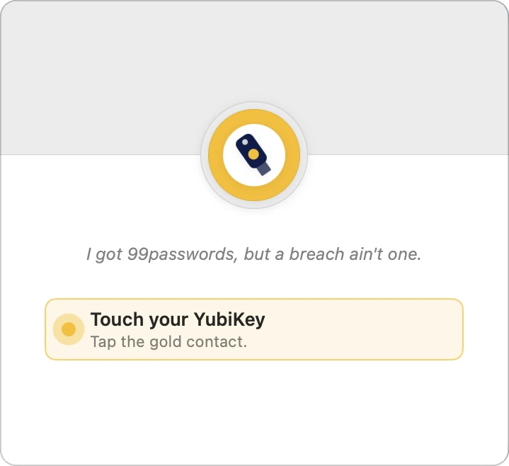
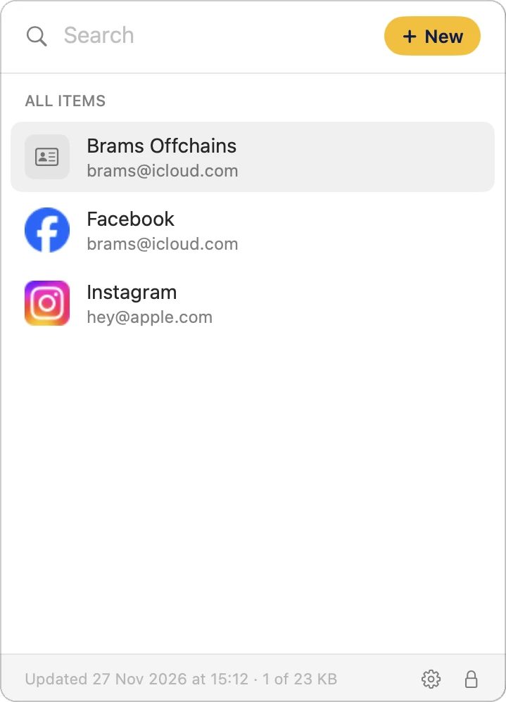
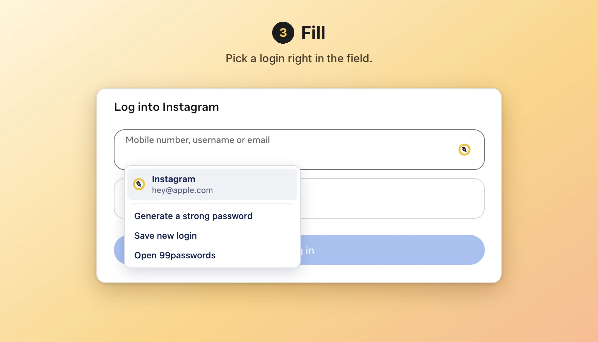

<p align="center"></p>

<p align="center">
  <a href="https://github.com/bramsoffchains/99p/actions/workflows/ci.yml"></a>
  <a href="https://github.com/bramsoffchains/99p/releases/latest"></a>
  <a href="LICENSE"></a>
  
</p>

# 99passwords

> "I got 99passwords, but a breach ain't one."

A macOS password manager whose vault lives **only on your YubiKey**. No cloud,
no account, no vault file on your computer. To unlock it you type your master
password and touch the key.

## Sneak peek

<p align="center">
  
  
</p>
<p align="center">
  
</p>

## Why

I started this after the recent 1Password breach. It made me ask why I had to
give my information to a company at all, and why a copy of my vault had to
sit on someone else's servers.

The main worry is simple: an encrypted vault that can be copied can be stolen
today and broken later. Quantum computers and AI-assisted attacks are making
that risk grow every year, and an encrypted file that leaks now could be
opened years from now. The safest vault is one that is never in the cloud and
never on a device's disk, so there is no copy sitting around to be stolen
and cracked later. To even get the encrypted data, someone needs your key in
hand, or code running on your Mac while the key is plugged in.

Most people who care about security already own a YubiKey. It is built to
keep secrets safe, it has room for a password vault, and it keeps doing
everything else it already does for you. So 99passwords puts the vault there.

## What you get

- A menu bar app for macOS to browse, search, add and edit logins, cards,
  secure notes and identities, with one-time (TOTP) codes and a password
  generator.
- A Chrome extension that fills logins on the right site, through the app.
- Clone your vault to a second YubiKey, or export an encrypted backup file.
- CSV/JSON import and export, to move in from another password manager or out.

## How it works

- Your vault is encrypted and stored in the YubiKey's memory, nowhere else.
- Opening it needs two things at once: your master password and a touch of
  the key. Someone with only one of them gets nothing.
- The YubiKey itself checks each password attempt and locks after 255 wrong
  ones, so nobody can sit and guess, not even with the key in hand.
- The vault is encrypted with ChaCha20-Poly1305, a widely used standard
  (RFC 8439) that also protects TLS 1.3 and WireGuard. It is fast and safe
  on any CPU.
- The app locks itself when you step away, put the Mac to sleep or pull out
  the key, and clears copied passwords from the clipboard after 30 seconds.

The full technical design is in [`docs/SPEC.md`](docs/SPEC.md).

## Install

You need a Mac with macOS 14 or later and a YubiKey 5.

### 1. The app

Download `99passwords-…-macos-arm64.zip` from the
[latest release](https://github.com/bramsoffchains/99p/releases/latest)
(Apple silicon), unzip it and move `99passwords.app` into Applications. The
app is not signed with an Apple Developer ID, so the first time macOS blocks
it: open it once, then click **Open Anyway** in System Settings → Privacy &
Security. The release notes have the details.

Or build it from source, with Rust (stable) and the Xcode Command Line Tools
(Xcode itself is not needed):

```sh
git clone https://github.com/bramsoffchains/99p.git && cd 99p
macos/build-app.sh
open macos/build/99passwords.app
```

The app appears in the menu bar. Plug in your YubiKey and follow the setup.
**Setting up a YubiKey takes over its PIV application** (the smart card part
used for certificates): it gets a new PIN and management key that only
99passwords knows. Its other features, like OTP, FIDO2 and passkeys, keep
working as before. If you already use PIV certificates on a key, use another
one.

To have it start with your Mac, put `99passwords.app` in Applications and add
it in System Settings → General → Login Items.

### 2. The Chrome extension

The extension is only a bridge to the app: it stores nothing and never sees
your vault, only the one login it is filling. It asks the app for the login
of the site you are on and fills the form, so it is just a convenient way to
fill in logins and forms. Everything else happens in the app, which works
fine without it.

> A release on the Chrome Web Store is coming soon. Until then, load it by
> hand; it takes a minute.

1. Open `chrome://extensions` in Chrome.
2. Turn on **Developer mode** (top right).
3. Click **Load unpacked** and pick the `extension` folder of this repository,
   or the unzipped `99passwords-extension-….zip` from the release.
4. Optional: click the puzzle icon in the toolbar and pin 99passwords.

That's it: the app connects Chrome to your vault by itself every time it
starts, so there is nothing else to set up. Keep the app running, unlock it,
and on a login page click the 99passwords icon in the field (or press
Cmd+Shift+L) to fill.

More details: [`macos/README.md`](macos/README.md) for the app and
[`extension/README.md`](extension/README.md) for the extension.

## Repository layout

```
crates/
  core/     ykvault-core: model, TLV, crypto, container, PIV APDU client, A/B
            storage, session, merge, .ykv and CSV/JSON export, TOTP, generator,
            MockYubiKey (in-memory YubiKey 5 used by the tests)
  pcsc/     ykvault-pcsc: PCSC.framework transport and removal watcher (macOS)
  ffi/      ykvault-ffi: plain C ABI staticlib for the app, include/ykvault.h
  cli/      ykvault: small admin CLI for a real YubiKey (info, piv-reset)
  bridge/   ykvault-bridge: Chrome native messaging host <-> app socket
macos/      the menu bar app (Swift package); BridgeServer/ is the app-side
            socket server for the browser bridge
extension/  Chrome MV3 extension, vanilla JS, no dependencies
docs/       SPEC.md: format, crypto, protocol and threat model
scripts/    checks (run locally and in CI)
```

## Build and test

```sh
scripts/check.sh                                      # any OS: Rust, C header, dependency policy, extension
cargo test -p ykvault-pcsc && scripts/swift-tests.sh  # macOS only
```

GitHub Actions runs the same checks on every push and pull request (Linux
and macOS); tests that need a real YubiKey are skipped there. Pushing a `v*`
tag builds the app and the extension and publishes a release. See
[`CONTRIBUTING.md`](CONTRIBUTING.md).

## Contributing and security

- How to contribute: [`CONTRIBUTING.md`](CONTRIBUTING.md). Coding agents
  should read [`AGENTS.md`](AGENTS.md).
- Found a vulnerability? Please report it privately, see [`SECURITY.md`](SECURITY.md).
- Code of conduct: [`CODE_OF_CONDUCT.md`](CODE_OF_CONDUCT.md).

## License

MIT, see [`LICENSE`](LICENSE). The bundled EFF Large Wordlist
(`crates/core/data/eff_large_wordlist.txt`) is by the Electronic Frontier
Foundation under CC BY 3.0 US, see [`crates/core/data/README.md`](crates/core/data/README.md).
YubiKey is a trademark of Yubico AB; this project is not affiliated with Yubico.
